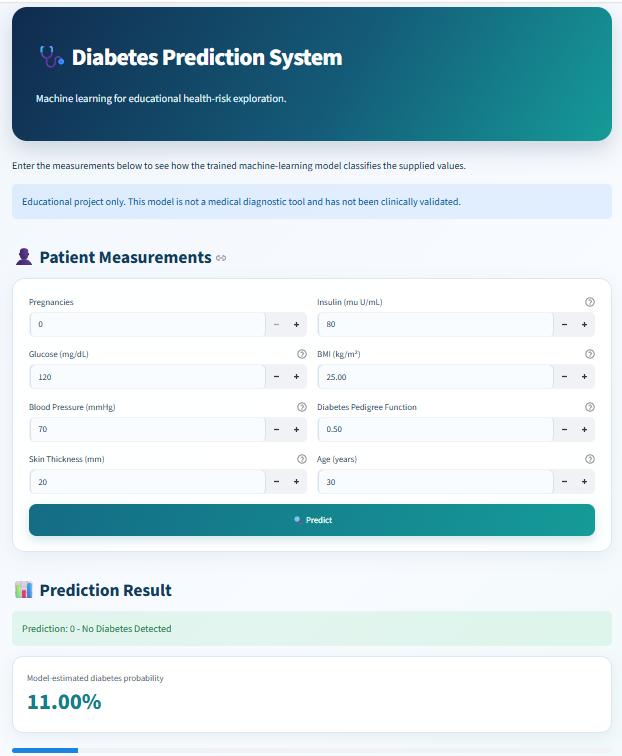
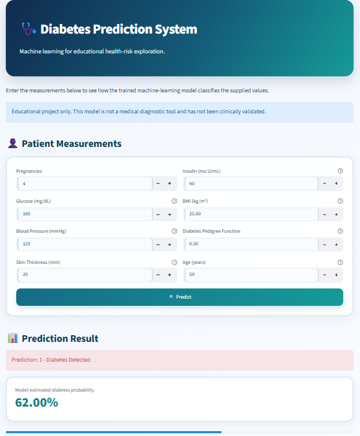

# Diabetes Prediction Using Machine Learning

# Project Overview
The Diabetes Prediction System is a machine learning project that predicts diabetes outcomes based on health-related measurements. It uses the Pima Indians Diabetes Dataset and a Random Forest Classifier.

# Technologies Used
- Python
- Pandas
- NumPy
- Matplotlib
- Seaborn
- Scikit-learn
- Streamlit
- Joblib

# Dataset
- Dataset: Pima Indians Diabetes Dataset
- Total Records: 768
- Input Features: 8
- Target Variable: Outcome (0 or 1)

# Machine Learning Algorithms
The following algorithms were trained and compared:
- Logistic Regression
- Decision Tree
- Random Forest
- K-Nearest Neighbors (KNN)
- Support Vector Machine (SVM)

*Final Selected Model:* Random Forest Classifier.

# Project Features
- Data cleaning and preprocessing
- Exploratory Data Analysis (EDA)
- Data visualization
- Training and comparison of machine learning models
- Model evaluation
- Diabetes prediction (0 or 1)
- Model-estimated diabetes probability
- Interactive Streamlit web application

# Prediction Output
- **0:** No Diabetes Detected
- **1:** Diabetes Detected
- Displays the model-estimated probability for class 1.

# Project Files
- `app.py` – Streamlit web application
- `diabetes_model.pkl` – Trained machine learning model and scaler
- `diabetes.csv` – Dataset
- `Diabetes_Prediction.ipynb` – Kaggle notebook containing the complete coding process
- `requirements.txt` – Required Python libraries

# How to Run the Project

*Step 1: Clone the repository*

```bash
git clone YOUR_GITHUB_REPOSITORY_URL
```

*Step 2: Install dependencies*

```bash
pip install -r requirements.txt
```

*Step 3: Run the application*

```bash
streamlit run app.py
```

# Disclaimer
This project is developed for educational purposes only. It is not clinically validated and should not be used as a medical diagnostic tool.

## Application Screenshots

### Home Page


### Prediction Result



